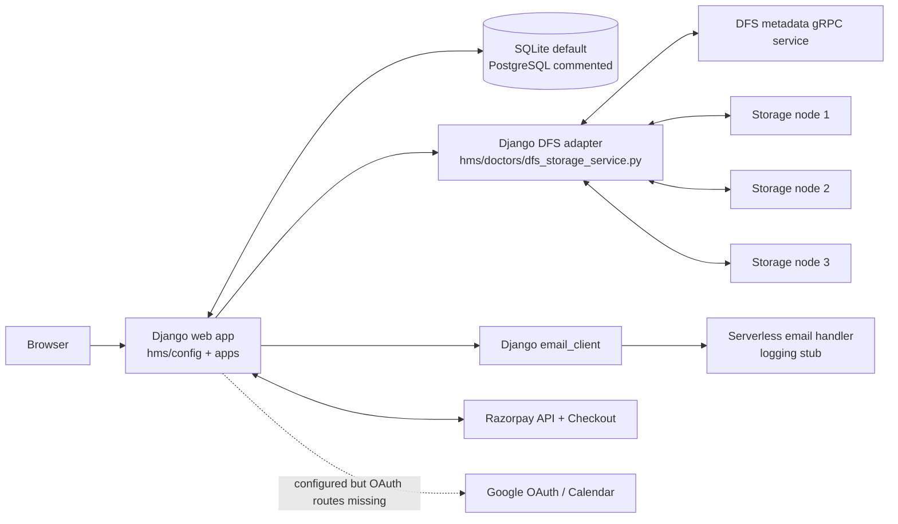
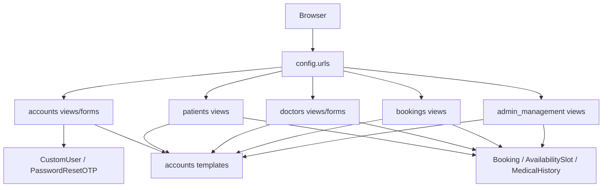
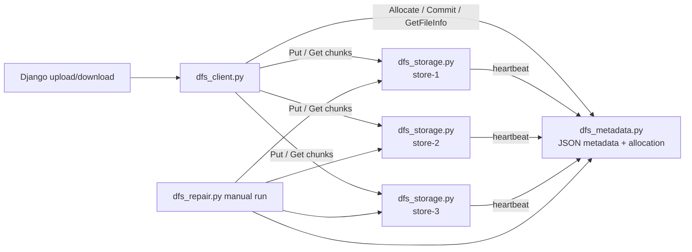
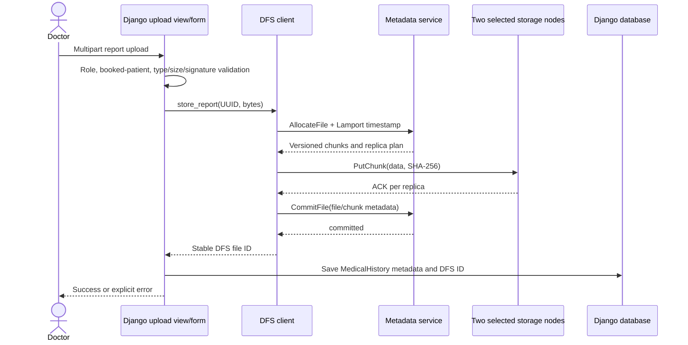
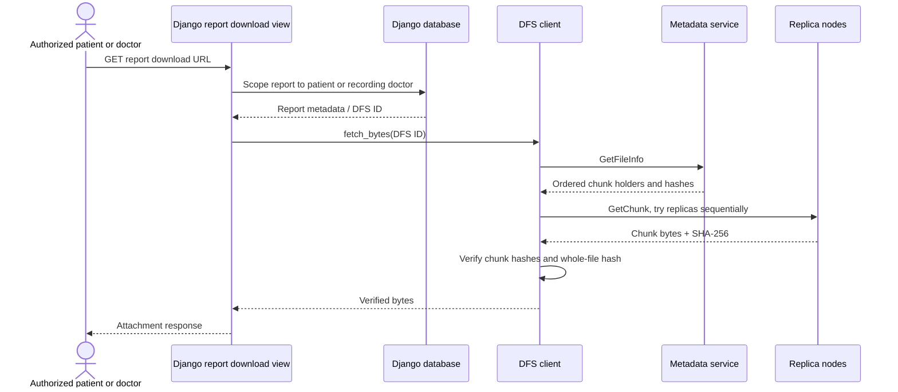

# MediFlow-Nexus — Complete Project Audit

**Audit date:** 2026-11-09  
**Project directory:** `MediFlow-Hospital-Management-Platform/`  
**Repository URL supplied:** `https://github.com/MuktaRedij/MediFlow-Nexus`

## Scope and method

This was a read-only source and configuration audit. No application files were changed, no database or migration command was run, no dependency was installed or updated, and nothing was staged, committed, pushed, or published. Tests were inspected but not run because their Django test runner creates a test database and the audit instructions prohibit database modification.

The recursive filesystem inventory counted **12,743 files in 3,622 child folders**. Most of the count is generated or local-only material: the local `venv/` has about 12,108 files, `.git/` has Git metadata, `dfs_data/` has 317 runtime files, and Python cache folders contain compiled files. The application/source-oriented inventory outside those large generated/runtime folders and caches has **157 files**, including source, templates, local databases, and binary test/runtime artifacts. Repetitive package files and generated runtime payloads are grouped below rather than individually described.

## 1. Project overview and complete folder inventory

MediFlow-Nexus is a server-rendered Django hospital/appointment application with an experimental three-node gRPC distributed file store used by medical-report upload/download flows. A separate Serverless Framework Python handler is intended to provide email actions. Razorpay and Google Calendar integrations are present in code, but important setup and wiring gaps remain.

### Top-level tree

```text
MediFlow-Hospital-Management-Platform/
├── .git/                         Git metadata and sample hooks; not application source
├── dfs_data/                     Local DFS metadata and storage-node chunk data
│   ├── metadata.json
│   ├── store-1/                  Replicated chunk files
│   ├── store-2/                  Replicated chunk files
│   └── store-3/                  Replicated chunk files
├── email-service/                Serverless Python email-action handler
├── hms/                          Django project, apps, templates, tests, local data
├── k8s/                          Empty; no Kubernetes manifests were found
├── proto/                        Protocol Buffers source definition
├── venv/                         Local Python virtual environment; do not upload
├── __pycache__/                  Root Python bytecode cache
├── .dfs_client_clock             Local DFS Lamport-clock state
├── .env.example                  Root example environment variables
├── .gitignore                    Ignore rules for local/generated files
├── deadlock_ready.txt            Local DFS/test marker file
├── dfs_client.py                 DFS client and command-line interface
├── dfs_metadata.py               DFS metadata gRPC server
├── dfs_pb2.py                    Generated Protocol Buffers Python module
├── dfs_pb2_grpc.py               Generated gRPC Python stubs
├── dfs_repair.py                 Manual replica-repair utility
├── dfs_storage.py                DFS storage-node gRPC server
├── net_config.py                 Local/container DFS host resolution
├── out1.bin, out2.bin, out3.bin,
│   out4.bin, photo.bin,
│   second.bin, second_out.bin    Opaque local binary data/output artifacts
├── requirements.txt              DFS Python dependency pins
└── [proto, hms, email-service, k8s, venv, dfs_data, .git, cache folders]
```

The seven root `.bin` files were treated as opaque binary artifacts; their contents were not interpreted as application source. `dfs_data/` contains one metadata file and three node directories with chunk data. The local payloads/database contents were not printed or copied into this report.

### Folder purpose and connections

| Folder | Purpose and important contents | Connections and audit notes |
|---|---|---|
| `.git/` | Git repository internals, including standard sample hooks. | The repository currently has **zero tracked files**; the application appears as untracked working-tree content. Do not upload `.git/` as project content. |
| `dfs_data/` | Runtime JSON metadata plus three storage-node directories; 317 files were counted. | Written by `dfs_metadata.py` and `dfs_storage.py`. Contains persistent local state/chunks and must not be published. |
| `email-service/` | `handler.py`, `serverless.yml`, `requirements.txt`, and its README. | Django posts to its `/send-email` endpoint through `hms/services/email_client.py`. Its handler currently logs actions rather than sending messages. |
| `hms/` | Django project, seven application packages, shared services, templates, migrations, tests, and local media/database files. | Main web application; its report adapter imports the root DFS client. |
| `hms/accounts/` | Custom authentication/user models, registration/login/reset-password views, forms, migrations, and demo-user command. | Provides the `CustomUser` model used by bookings, doctors, and administration. |
| `hms/admin_management/` | Department, specialization, transaction, approval, and audit-log models/views/templates, plus seed command and migrations. | Depends on users, bookings, and doctor models. Some detail views refer to a nonexistent `doctors.models.Doctor`. |
| `hms/bookings/` | Booking model, appointment/payment views, URLs, reminder command, and migrations. | Connects patients and doctors to availability slots; calls payment, email, and calendar integrations. |
| `hms/config/` | Django settings, root URL map, WSGI/ASGI entry points, and a custom `runserver` command. | Registers the Django apps and selects SQLite by default. `config` is not in `INSTALLED_APPS`, so its custom command is not normally discoverable by Django’s app command loader. |
| `hms/doctors/` | Doctor-side models, views, forms, upload validators, DFS adapter, admin setup, tests, and migrations. | Reads/writes report bytes through the root gRPC DFS client; views are role-gated by a local decorator. |
| `hms/media/` | Runtime media directory containing `profile_photos/profile.jpg`. The two SQLite files are at the `hms/` root, not inside `media/`. | Runtime/user data, not source. Treat the image and database files as potentially personal or sensitive and exclude them. |
| `hms/notifications/` | Notification templates and cache/migration bytecode only; no usable Python source was found. | Not installed in Django settings and has no notification routes/views/models in source. Its templates are unreferenced. |
| `hms/patients/` | Patient dashboard/doctor/slot/booking/profile/report views, URLs, access tests, app config, and minimal admin module. | Uses the shared user, booking, availability, and medical-history models. There is no patient-specific model file. |
| `hms/services/` | Email HTTP client, Google Calendar OAuth/event helper, and a console email backend. | Shared by accounts/bookings. The console backend is not configured in settings; Google Calendar functions are not routed. |
| `hms/templates/` | 49 server-rendered HTML templates for common pages and role-specific experiences. | Rendered by Django views. Styling and most JavaScript are inline; Bootstrap, Font Awesome, and Razorpay Checkout are loaded from external CDNs. |
| `hms/**/migrations/` | 15 application migration files plus package `__init__.py` files. | Define the historical schema for accounts, admin management, bookings, and doctors. Preserve these in Git. |
| `email-service/` | Standalone Serverless Framework Lambda configuration and Python handler. | Does not have a `package.json`; the documented Serverless plugins must be installed/provided separately. |
| `k8s/` | Empty directory. | There are no Kubernetes, Docker Compose, or container deployment manifests in the inspected project tree. |
| `proto/` | `dfs.proto`. | Source definition for the generated root-level `dfs_pb2.py` and `dfs_pb2_grpc.py`. Keep all three in Git. |
| `venv/` | Local `Include/`, `Lib/`, `Scripts/`, and `pyvenv.cfg`, with installed Django, gRPC, protobuf, Selenium, Google, Razorpay, and other packages. | Local environment only; recreate from the appropriate requirements files rather than uploading it. |
| `__pycache__/` and nested caches | Compiled `.pyc` bytecode. | Generated by Python and covered by ignore rules. |

### Root-level files

| File | Language/format | Responsibility and dependencies |
|---|---|---|
| `dfs_client.py` | Python | DFS client API and CLI (`put`, `get`, `status`). Calls the generated gRPC stubs and `net_config`; splits data into chunks, requests allocation, writes replicas, commits metadata, and verifies chunk/file hashes on reads. |
| `dfs_metadata.py` | Python | Metadata gRPC service; persists node addresses, file/chunk metadata, and logical clock in `dfs_data/metadata.json`. Allocates replicas, commits files, reports liveness/status, and records repaired replicas. |
| `dfs_storage.py` | Python | Storage-node gRPC server. Implements chunk put/get, validates SHA-256 on write, writes through a temporary file and atomic replace, and sends periodic heartbeats. |
| `dfs_repair.py` | Python | Manually scans committed chunks, verifies live copies, copies healthy bytes to repair targets, and updates metadata through `AddReplica`. |
| `net_config.py` | Python | Maps logical service names to localhost or Docker DNS/ports based on `RUN_ENV`; controls bind address. It does not configure TLS or authentication. |
| `proto/dfs.proto` | Protocol Buffers | Declares metadata and storage services, RPCs, and message schemas for heartbeats, allocation, commit, file info, chunk transfer, status, and replica update. |
| `dfs_pb2.py` | Generated Python | Generated protobuf message/descriptor classes from `proto/dfs.proto`; generated against protobuf 7.35.1. |
| `dfs_pb2_grpc.py` | Generated Python | Generated gRPC client/server classes; requires grpcio 1.83.0 or newer, matching the root requirements pin. |
| `requirements.txt` | Requirements text | Pins the DFS runtime/tooling dependencies: `grpcio`, `grpcio-tools`, `protobuf`, `redis`, `async-timeout`, and `typing_extensions`. Redis-related packages were not referenced by inspected application code. |
| `.env.example` | Environment example | Documents Django, database, OAuth, email, and Razorpay settings. Credential values are placeholders, not actual values; some local examples do not agree with the Django service setup. |
| `.gitignore` | Git ignore rules | Ignores many environments, caches, DB files, media, DFS runtime files, `.env`, logs, and binary files. See the upload recommendations below for gaps and duplicate rules. |
| `.dfs_client_clock` | Runtime text state | Persists the local DFS client logical-clock value; local-only. |
| `deadlock_ready.txt` | Runtime/test marker | Small local marker artifact; not application source. |
| `out1.bin`, `out2.bin`, `out3.bin`, `out4.bin`, `photo.bin`, `second.bin`, `second_out.bin` | Binary | Opaque local input/output payloads; not required application source and should stay excluded. |

## 2. Django backend architecture and file inventory

### Django configuration and request routing

- [`hms/manage.py`](hms/manage.py) sets `DJANGO_SETTINGS_MODULE=config.settings` and dispatches management commands.
- [`hms/config/settings.py`](hms/config/settings.py) configures installed apps, Django middleware, template discovery, custom user model, default SQLite database, media/static roots, session/CSRF settings, and external-service settings. It includes a commented PostgreSQL configuration; the active database is SQLite.
- [`hms/config/urls.py`](hms/config/urls.py) maps `/` to the home view; `/admin/` to Django admin; `/dashboard/` to admin-management URLs; `/auth/`, `/doctors/`, `/patients/`, and `/bookings/` to their app URL modules. It explicitly blocks the public medical-record media path and appends development media serving when `DEBUG` is true.
- [`hms/config/wsgi.py`](hms/config/wsgi.py) and [`hms/config/asgi.py`](hms/config/asgi.py) expose WSGI and ASGI applications.
- The configured middleware is Django’s security, session, common, CSRF, authentication, messages, and clickjacking middleware. No custom middleware is registered.
- `hms/config/management/commands/runserver.py` extends Django’s runserver to open a local browser. Because `config` is a project package and is not in `INSTALLED_APPS`, this custom command is not expected to be discovered as an installed-app command.
- `django-rest-framework` is listed as a dependency but no REST API views, serializers, router, or `rest_framework` app registration were found. The product surface is server-rendered HTML rather than a verified JSON API.

### Applications, important files, and relationships

#### `hms/accounts/`

| File | Responsibility and connections |
|---|---|
| `models.py` | `CustomUser` extends Django `AbstractUser`, adds doctor/patient roles, a Google Calendar token JSON field, and a 2FA-enabled flag. `PasswordResetOTP` is one-to-one with the user and expires after ten minutes. The 2FA flag has no corresponding authentication flow. |
| `forms.py` | Doctor/patient signup forms normalize email and assign roles; custom authentication form looks up users by email and checks the password. Used by `views.py`. |
| `views.py` | Home and dashboard dispatch; doctor/patient registration; login/logout; forgot/reset password; and Google Calendar connect/callback functions. Calls shared email and calendar services. The OAuth functions have no URL patterns. Signup catches email exceptions and silently discards them. |
| `urls.py` | Routes signup, login/logout, password reset, and dashboard. Does not route `google_calendar_connect` or `google_calendar_callback`. |
| `admin.py` | Registers the custom user with Django admin and exposes role plus the stored Google token field. |
| `apps.py` | Declares `AccountsConfig`. |
| `management/commands/create_demo_users.py` | Creates or updates demo admin/doctor/patient records and prints their credentials. It contains hard-coded default credentials; do not publish those values or run this command against a real database. |
| `migrations/0001_initial.py`, `0002_passwordresetotp.py`, `0003_customuser_is_2fa_enabled.py` | Initial custom user schema, password-reset OTP model, and 2FA flag change. Preserve migration source. |
| `__init__.py`, `management/__init__.py`, `management/commands/__init__.py`, `migrations/__init__.py` | Python package markers. |

#### `hms/doctors/`

| File | Responsibility and connections |
|---|---|
| `models.py` | Defines `AvailabilitySlot`, `ConsultationNote`, `Prescription`, `Earning`, `DoctorRating`, `TelemedicineSession`, and `MedicalHistory`. These relate users to slots, appointments, medical notes/reports, payments, ratings, and a planned telemedicine session. |
| `views.py` | Doctor dashboard, appointment listing/search, consultation notes, prescriptions, earnings, patient history, ratings/replies, availability CRUD, profile editing, and report upload. Role checks use `doctor_only`; report upload calls the DFS adapter. Several routes render templates that are absent from this tree. |
| `forms.py` | Availability form validates future dates, time ordering, and duplicate slots; profile form edits user fields; report form limits patients to those with a booking for the doctor and validates an optional upload. |
| `validators.py` | Restricts medical documents to PDF/DOC/DOCX/JPG/JPEG/PNG, 10 MiB, and checks signatures (DOCX ZIP members included). |
| `dfs_storage_service.py` | Django-to-DFS adapter. Adds the repository root to `sys.path`, calls `dfs_client.store_bytes`/`fetch_bytes`, and maps DFS errors to domain exceptions. |
| `urls.py` | Maps doctor dashboard, appointments/notes, availability, profile, report upload, prescriptions, patient history, earnings, and ratings. |
| `admin.py` | Registers `AvailabilitySlot` for Django admin with doctor/date/booked filters. |
| `apps.py` | Declares `DoctorsConfig`. |
| `tests.py` | Seven Django tests for report upload validation/association, AJAX response, role denial, DFS failure, and database-save failure behavior. DFS calls are mocked rather than exercising a live cluster. |
| `migrations/0001_initial.py` through `0006_medicalhistory_dfs_storage.py` | Initial doctor schema, availability changes, additional models, consultation fields, slot changes, and DFS report metadata fields. |
| `__init__.py`, `migrations/__init__.py` | Package markers. |

#### `hms/patients/`

| File | Responsibility and connections |
|---|---|
| `views.py` | Patient dashboard, doctor/slot browsing, bookings, profile, medical-report list/download, and a hard 404 for public report-media access. The download view scopes records to the authenticated patient or the recording doctor and reads DFS bytes where a DFS ID exists. |
| `urls.py` | Patient dashboard, doctors, slots, bookings, profile, report listing, and report download routes. |
| `tests.py` | Nineteen Django tests for patient/doctor access controls, local and DFS report downloads, missing files/storage behavior, media-route blocking, and upload validation. |
| `apps.py` | Declares `PatientsConfig`. |
| `admin.py` | No model registrations; it only imports Django admin. |
| `__init__.py` | Package marker. |
| `models.py` | No patient-specific model exists; the custom user and shared app models represent patient data. |

#### `hms/bookings/`

| File | Responsibility and connections |
|---|---|
| `models.py` | `Booking` references a patient, doctor, and one availability slot; stores fee/payment state and reminder flags. `clean()` checks that the slot can be booked. |
| `views.py` | Creates/cancels bookings, initiates Razorpay orders, verifies payments, creates transaction rows, and calls email/calendar integrations. It contains a local mock-order fallback and a test-payment verification branch that bypasses signatures. |
| `urls.py` | Routes booking, cancellation, payment initiation, and payment verification. |
| `admin.py` | Registers `Booking` with search/filter/date hierarchy in Django admin. |
| `apps.py` | Declares `BookingsConfig`. |
| `management/commands/send_appointment_reminders.py` | Selects bookings for 24-hour/1-hour reminders, calls the shared email client, and marks sent flags. It is an on-demand management command; no scheduler is included. |
| `migrations/0001_initial.py`, `0002_booking_reminder_sent_1h_booking_reminder_sent_24h.py`, `0003_booking_payment_fields.py` | Initial booking schema, reminder flags, and payment fields. |
| `__init__.py`, `management/__init__.py`, `management/commands/__init__.py`, `migrations/__init__.py` | Package markers. |

#### `hms/admin_management/`

| File | Responsibility and connections |
|---|---|
| `models.py` | `Department`, `Specialization`, `Transaction`, `DoctorApproval`, and `SystemAuditLog`. Department/specialization doctor-count properties are TODO stubs returning zero. |
| `views.py` | Staff/admin-gated dashboards, user management, doctor approvals, audit logs, department/specialization CRUD, transaction listing, and admin profile/password changes. Depends on users, bookings, and its own models. |
| `urls.py` | Route map for all admin-management pages and action endpoints. |
| `apps.py` | Declares `AdminManagementConfig`. |
| `management/commands/seed_departments.py` | Populates sample departments and specializations. This modifies the database if run; it was not run during the audit. |
| `migrations/0001_initial.py`, `0002_department_transaction_specialization.py`, `0003_department_code_department_status_and_more.py` | Initial admin-management models and subsequent department/specialization changes. |
| `__init__.py`, `management/__init__.py`, `management/commands/__init__.py`, `migrations/__init__.py` | Package markers. |

**Verified backend gaps:** `department_detail` and `specialization_detail` import `Doctor` from `doctors.models`, but that model is not defined; those views will fail when invoked. Admin profile code assigns `phone` to `CustomUser`, which has no declared phone field. Doctor registration does not create a `DoctorApproval` record, while the admin approval UI queries those records. The `reject` action is listed but not implemented. Department/specialization count properties are placeholders.

#### `hms/services/`

| File | Responsibility and connections |
|---|---|
| `email_client.py` | Sends signup, password-reset, booking, cancellation, and reminder requests to `${EMAIL_SERVICE_URL}/send-email`; called by accounts/bookings. Some methods log OTPs in development; signup/cancellation paths suppress failures, and booking calls do not consistently check HTTP status. |
| `google_calendar.py` | Uses Google OAuth libraries and a local `credentials.json` to acquire tokens and insert calendar events. It stores access/refresh tokens and client secret in `CustomUser.google_calendar_token`. It is called by payment verification; OAuth endpoints are not routed. |
| `console_email_backend.py` | Django email backend that logs recipients/subjects instead of delivering. It is not selected in `settings.py`. |
| `__init__.py` | Package marker. |

#### `hms` project-root support files

- `manage.py`: Django command entry point.
- `requirements.txt`: Django dependencies (details in §7).
- `debug_login.py`: local DB credential diagnostic. It embeds demo credentials and can print user details and part of a stored password hash; do not publish without removing sensitive defaults/output.
- `test_login_selenium.py`: standalone Selenium/Chrome login script, not a Django `TestCase`; it embeds demo credentials and requires a running server and Chrome/driver.
- `.env.example`: Django-local environment sample.
- `.gitkeep`: empty directory-preservation marker.
- `.dfs_client_clock`: local DFS clock.
- `db.sqlite3` and `db_backup_20261022_213448.sqlite3`: local databases/backups; potentially contain user, appointment, payment, or medical data. Do not upload.
- `media/profile_photos/profile.jpg`: image under a runtime media path; treat as potentially personal and do not upload unless its ownership/consent and intended public use are verified.

#### Migrations inventory

All migration source files below should be retained in Git; the database files themselves should not:

- Accounts: `0001_initial.py`, `0002_passwordresetotp.py`, `0003_customuser_is_2fa_enabled.py`.
- Admin management: `0001_initial.py`, `0002_department_transaction_specialization.py`, `0003_department_code_department_status_and_more.py`.
- Bookings: `0001_initial.py`, `0002_booking_reminder_sent_1h_booking_reminder_sent_24h.py`, `0003_booking_payment_fields.py`.
- Doctors: `0001_initial.py`, `0002_availabilityslot_is_recurring_and_more.py`, `0003_add_missing_models.py`, `0004_add_consultation_note_fields.py`, `0005_add_availabilityslot_fields.py`, `0006_medicalhistory_dfs_storage.py`.
- Patients: no application migration source was found.
- Notifications: no usable migration source was found; only compiled cache files remain.

## 3. Frontend audit

### Template inventory and user interfaces

There are **49 Django templates**. There is no local CSS or JavaScript file tree; styles and scripts are inline in HTML. Dashboard shell pages load Bootstrap 5.3 and Font Awesome 6.4 from CDNs; payment pages load Razorpay Checkout. This means the UI depends on external network/CDN availability.

| Template group | Files | Purpose and view connection |
|---|---|---|
| Shared | `base.html`, `csrf_error.html`, `landing.html` | Shared basic shell, CSRF error page, and public login/registration landing interface. `accounts.views.home` renders landing; CSRF failures use the configured error view. |
| Accounts | `accounts/doctor_signup.html`, `accounts/patient_signup.html`, `accounts/forgot_password.html`, `accounts/reset_password.html`, `accounts/google_calendar_info.html` | Role-specific registration and password reset. `google_calendar_info.html` has no literal Python render reference and appears unused. |
| Admin | `admin_management/base_admin.html`, `dashboard.html`, `departments.html`, `department_detail.html`, `edit_profile.html`, `manage_doctors.html`, `manage_users.html`, `specializations.html`, `specialization_detail.html`, `system_logs.html`, `transactions.html` | Admin shell and admin dashboards/management pages. Several detail views have model issues noted above. |
| Bookings | `bookings/payment.html`, `bookings/payment_modal_content.html` | Full-page and AJAX payment interfaces; use Razorpay’s remote Checkout script. |
| Doctor | `doctors/base_doctor.html`, `create_availability.html`, `create_availability_content.html`, `dashboard.html`, `dashboard_content.html`, `edit_profile.html`, `edit_profile_content.html`, `manage_availability.html`, `manage_availability_content.html`, `upload_report.html`, `upload_report_content.html`, `view_bookings.html`, `view_bookings_content.html` | Doctor shell, dashboards, availability, profile, report upload, and bookings. Full and content fragments are selected by AJAX query/header paths in the doctor views. |
| Patient | `patients/base_patient.html`, `bookings_iframe.html`, `dashboard.html`, `dashboard_iframe.html`, `doctors_iframe.html`, `medical_reports.html`, `medical_reports_content.html`, `my_bookings.html`, `patient_profile.html`, `profile_iframe.html`, `slots_iframe.html`, `view_doctors.html`, `view_slots.html` | Patient shell, dashboards, doctor/slot browsing, bookings, profile, and medical-report list/download. AJAX requests render the content/iframe variants. |
| Notifications | `notifications/notifications_list.html`, `notifications/notification_widget.html` | No source view, model, route, or installed app references these templates; they are currently unreferenced. |

### Frontend-to-backend communication

- Ordinary forms submit to Django URL names and are processed by view functions; templates include CSRF tokens in the checked upload forms.
- Patient and doctor dashboards selectively return full templates or content-only templates when `?ajax=1` is set. Doctor availability also detects `XMLHttpRequest`.
- Medical-report upload posts multipart form data to `doctors.views.upload_patient_report`; download links route to `patients.views.download_medical_report`.
- The payment page loads Razorpay Checkout and posts a JSON response to Django’s payment-verification route. The server owns order generation and payment-state updates.
- External styles/scripts are not pinned or vendored locally; there are no static CSS/JS assets discovered in the project.

### Missing, unused, or inconsistent frontend

1. **Nine doctor views render templates that do not exist:** `doctors/appointments.html`, `add_note.html`, `prescriptions.html`, `create_prescription.html`, `earnings.html`, `medical_history.html`, `add_medical_history.html`, `ratings.html`, and `reply_review.html`. Visiting those routes will fail with a template lookup error.
2. `accounts/google_calendar_info.html` is not rendered by a source view.
3. Both notification templates are unreferenced, and the notification app source is absent/uninstalled.
4. `hms/config/settings.py` points `STATICFILES_DIRS` at `hms/static`, but no such local asset directory was found.
5. Styles are duplicated inline among base/page templates; there are no local CSS/JS build inputs or frontend package manifest.

## 4. Backend behavior and feature request flows

### Model relationships and implemented data

- `CustomUser` is the project’s shared doctor/patient/admin identity. Doctor and patient roles are stored on the same user model; admins are principally determined by Django staff/superuser state.
- `PasswordResetOTP` is one-to-one with a user.
- `AvailabilitySlot` belongs to a doctor. A uniqueness constraint prevents duplicate doctor/date/time ranges.
- `Booking` links one patient, one doctor, and one unique availability slot. It stores payment status/ID and reminder flags.
- `ConsultationNote`, `Prescription`, `Earning`, `DoctorRating`, `TelemedicineSession`, and `MedicalHistory` use doctor/patient relations; several depend on bookings.
- `MedicalHistory` stores report metadata in the Django database and either a legacy `FileField` path or a DFS file identifier/original filename.
- `Department` and `Specialization` relate administration data; `Transaction` relates to an optional booking and patient; `DoctorApproval` is one-to-one with a doctor; `SystemAuditLog` records an optional user, action, text, and IP.
- There is no separate patient profile model, Doctor profile model, notification source model, or video-conference provider integration.

### Important request flows

#### Registration/authentication/password reset

1. `config.urls` includes `/auth/` routes from `accounts/urls.py`.
2. Doctor/patient forms validate email and password, assign a role, save `CustomUser`, and call `send_signup_welcome`.
3. Login authenticates by email and redirects staff to the admin dashboard and doctor/patient users to their respective dashboards.
4. Password reset stores a six-digit OTP in `PasswordResetOTP`, calls the email service, then accepts OTP/new password on the reset form.

#### Appointment and payment

1. Doctor creates an availability slot through the doctor form/view.
2. Patient browses doctors/slots and submits a POST to `book_appointment`.
3. The view uses `transaction.atomic()` and `select_for_update()`, creates a pending `Booking`, marks the slot booked, then redirects to payment.
4. `initiate_payment` creates a Razorpay order or constructs a local test order after API failure.
5. Checkout calls `verify_payment`; the regular branch checks a Razorpay signature and marks the booking/transaction complete. The test branch trusts client-provided test indicators and skips signature verification.
6. Successful payment calls the email client and Google Calendar event creator.
7. Cancellation frees the slot and creates a refund transaction row, but no Razorpay refund API call was found.

The doctor dashboard’s earnings query uses `Earning`, while payment completion creates `Transaction` records and no `Earning` record in the inspected flow. Therefore the displayed earnings are not demonstrably populated by successful bookings.

#### Medical-report upload and viewing

1. The doctor-only upload view constructs `UploadPatientReportForm`, whose patient queryset is limited to patients who booked that doctor.
2. The validator checks extension, a 10 MiB maximum, and file signature; DOCX files are checked for expected ZIP members.
3. The view generates a UUID-based file identifier, calls `dfs_storage_service.store_report`, and saves metadata to `MedicalHistory`. It reports failures rather than claiming success if storage or DB save fails.
4. The patient report list filters by the authenticated patient. Downloads scope to the patient or the report’s doctor, use DFS when `dfs_file_id` exists, and otherwise serve legacy media files.
5. The root media URL for medical records is explicitly blocked.

## 5. Distributed Computing audit

### Components and file roles

- [`proto/dfs.proto`](proto/dfs.proto): authoritative service/message contract.
- [`dfs_pb2.py`](dfs_pb2.py): generated protobuf message classes.
- [`dfs_pb2_grpc.py`](dfs_pb2_grpc.py): generated gRPC service stubs and server registration functions.
- [`net_config.py`](net_config.py): local/Docker host mapping and bind addresses.
- [`dfs_client.py`](dfs_client.py): chunking, allocate/put/commit, retrieval, checksum validation, local CLI, and logical-clock persistence.
- [`dfs_metadata.py`](dfs_metadata.py): metadata service, node registrations, liveness, allocation/commit/status, and replica metadata.
- [`dfs_storage.py`](dfs_storage.py): one storage-node service process; stores chunks and heartbeats.
- [`dfs_repair.py`](dfs_repair.py): manual recovery workflow.
- [`hms/doctors/dfs_storage_service.py`](hms/doctors/dfs_storage_service.py): Django adapter; translates DFS errors into application-level exceptions.
- `hms/doctors/views.py`, `hms/patients/views.py`, and `MedicalHistory` fields: report upload/download integration and metadata.
- `dfs_data/`: runtime-only metadata and node payloads.
- No dedicated DFS cluster/integration test file was found.

### Concept-by-concept assessment

| Concept | Where/how implemented | Tested? | Limitations |
|---|---|---|---|
| Distributed client/server | Separate metadata server and three independently invoked storage nodes expose gRPC services. `net_config.py` provides fixed local/container names and ports. | No direct process/cluster test found. | Single metadata server; no replicated metadata service, scheduler, Docker Compose, or Kubernetes manifests. |
| File chunking | `dfs_client.py` slices byte content at `DFS_CHUNK_SIZE` (64 KiB default); empty data becomes one empty chunk. | Report tests mock the adapter; no chunk-boundary tests found. | All bytes are read into memory before chunking; no streaming/backpressure or configurable per-file limits. |
| Replication | `dfs_metadata.py` allocates factor 2 across up to three live nodes using current chunk counts; client requires every planned replica to ACK before commit. | No live replication test found. | Greedy placement; fixed node set; no anti-entropy/rebalance. Old chunks may remain after overwrite or partial failure. |
| Metadata management | JSON state records logical clock, addresses, file versions, sizes, whole-file checksums, chunks, per-chunk hashes, and holders. Writes use temporary file plus `os.replace`. | No direct persistence/restart test found. | JSON metadata is a single point of failure; pending allocations are in-memory and not recovered after restart. |
| gRPC / Protocol Buffers | The `.proto` declares metadata and storage RPCs; generated stubs implement typed unary RPCs. | Generated source and service wiring are present; no end-to-end gRPC test found. | Channels are insecure; no TLS, RPC authentication, or authorization. |
| Heartbeat | Storage nodes send heartbeats every 2 seconds to metadata. | No heartbeat test found. | Hard-coded interval; no authenticated registration or persisted health state. |
| Failure detection | Metadata considers a node alive for 6 seconds after its most recent heartbeat and reports transitions. | No failure simulation test found. | Monitor logs status; it does not automatically repair replicas or fail over metadata. |
| Replica fallback | `fetch_bytes` tries chunk holders in metadata order, skips unreachable/bad-checksum copies, then verifies the assembled file hash. Metadata sorts alive nodes first. | Patient tests mock `read_report`; no direct fallback test found. | Sequential reads; unavailable/corrupt replicas fail the download if no valid copy remains. |
| Manual replica repair | `dfs_repair.py` reads cluster status, verifies chunks, copies a valid live replica to repair targets, and calls `AddReplica`. | No repair test found. | Manual invocation only; cannot recover data when all live copies are bad/missing; no scheduling/alerting. |
| SHA-256 integrity | Client computes chunk/file hashes; storage validates writes; fetch and repair re-check hashes. | Upload form tests validate input signatures but do not exercise DFS checksum RPCs. | Hashes establish integrity, not confidentiality or authenticity against an untrusted metadata/storage service. |
| Lamport logical clocks | Client increments/persists `.dfs_client_clock`; metadata merges timestamps and ticks during allocation/commit. | No logical-clock/concurrency tests found. | Logical ordering only; not a distributed lock, transaction protocol, or conflict-resolution policy. |
| Concurrency control | Metadata service uses a `threading.Lock` around stateful RPC methods. Django booking uses DB transaction/row-lock patterns. | Report tests cover failure handling, not concurrent cluster/client calls. | The lock protects only one metadata process. The default SQLite backend does not provide production-grade row locking; client clock-file updates are not synchronized across concurrent processes. |

### DFS workflow details and limitations

- Metadata allocates versioned IDs like `filename.vN.cI` and two node addresses per chunk.
- The client writes all planned replicas and then commits metadata; incomplete writes leave potentially orphaned chunk payloads.
- Metadata state and chunk storage paths are relative to the process working directory, so process launch directories must be consistent.
- `dfs_storage.py` exposes ports bound to loopback in local mode and `0.0.0.0` in Docker mode. The service uses insecure channels in both configurations.
- There is no automatic garbage collection, replica repair trigger, metadata failover, access-control layer, or encryption at rest/in transit.
- The code has real chunking, replication, health tracking, manual repair, hashes, and Lamport counters; it does **not** implement consensus, quorum writes, distributed locking, or highly available metadata.

## 6. Email service audit

### Structure and API

- `email-service/handler.py`: Lambda-style `send_email(event, context)` parses the HTTP event body, routes six actions (`SIGNUP_WELCOME`, `PASSWORD_RESET_OTP`, patient/doctor booking confirmation, cancellation, reminder), checks required fields, and returns JSON status responses.
- `email-service/serverless.yml`: Serverless Framework v3 AWS provider, Python 3.11 runtime, `send-email` POST endpoint, and `serverless-offline` / `serverless-python-requirements` plugins.
- `email-service/requirements.txt`: `boto3` and `requests`; neither is imported by the current handler.
- `email-service/README.md`: installation/local/deploy instructions and sample payloads.

### Critical behavior distinction

The handler does **not** send email. Each action logs a message and returns a success-shaped response; there is no SMTP, SES, SendGrid, or other mail-provider call. Consequently Django may treat a welcome/OTP/booking email as sent when only a log line was produced. The handler also logs the OTP action details. This is a mock/demo endpoint, not a production email service.

The service can be invoked as a Lambda handler and is configured for Serverless offline/deployment, but independent local execution requires the Serverless CLI and both plugins. No `package.json` or local Node dependency manifest is present. README payload names such as `user_email`/`user_name` do not match the handler’s required `recipient_email`/`recipient_name` fields.

### Django integration and configuration mismatches

- `hms/services/email_client.py` POSTs JSON to `EMAIL_SERVICE_URL + "/send-email"`.
- `hms/.env.example` uses a local `:3000/dev` base matching the documented offline endpoint.
- Root `.env.example` instead uses a different local port/base, so it resolves to an endpoint inconsistent with the README.
- Environment examples use placeholder credentials; no mail-provider credentials are configured because no provider integration exists.
- Welcome email failures are swallowed in signup views. Other paths log/return errors inconsistently; booking HTTP responses are not always checked.

## 7. Dependency and integration audit

### Python requirements

| Manifest | Declared packages / use | Audit notes |
|---|---|---|
| Root `requirements.txt` | `grpcio==1.83.0`, `grpcio-tools==1.83.0`, `protobuf==7.35.1`, `redis==8.1.0`, `async-timeout==5.0.1`, `typing_extensions==4.16.0` | gRPC/protobuf are required by DFS. `grpcio-tools` is for regenerating stubs. Redis-related packages and `typing_extensions` were not directly referenced in the project source; verify whether any are intentionally needed before pruning. |
| `hms/requirements.txt` | Django 4.2.7, DRF 3.14.0, dotenv, requests, Google OAuth/API libraries, Razorpay, Selenium, psycopg2-binary | Django/requests/Google/Razorpay/Selenium are referenced. DRF is not wired into settings or routes. PostgreSQL is only a commented settings option while SQLite is active. Selenium supports only the standalone login script. |
| `email-service/requirements.txt` | `boto3`, `requests` | Neither is currently used by `handler.py`; no actual provider/HTTP call is implemented. |

`requests` is declared in both the Django and email-service manifests, but they are separate environments. No `package.json`, lockfile, or Node dependency manifest exists. The email-service README asks for global Serverless installation and plugin packages without a committed npm manifest/lock.

### External integrations actually referenced

- **Django:** active SQLite; commented PostgreSQL configuration and `psycopg2-binary`.
- **Distributed reports:** gRPC/protobuf to fixed local/container metadata and storage endpoints.
- **Google:** OAuth and Calendar API libraries; expects `hms/credentials.json`, which was not present in the inventory. OAuth URL/callback functions are not routed.
- **Razorpay:** order creation and signature verification code plus hosted Checkout JavaScript. Local fallback/test payment logic is also present.
- **Email:** HTTP calls to the Serverless handler; handler is a logging stub rather than an email provider.
- **Frontend:** Bootstrap and Font Awesome CDNs; Razorpay Checkout CDN.
- **Deployment:** Serverless AWS configuration only. No Dockerfile, Compose file, or Kubernetes manifests were found.

## 8. Security, privacy, and sensitive-file warnings

No credential values are reproduced in this report.

### Release blockers / high-priority findings

1. **Hard-coded demo credentials in source.** Demo email/password defaults and credential-printing behavior exist in [`hms/accounts/management/commands/create_demo_users.py`](hms/accounts/management/commands/create_demo_users.py), [`hms/debug_login.py`](hms/debug_login.py), and [`hms/test_login_selenium.py`](hms/test_login_selenium.py). The account identity appears personal rather than purely synthetic. Remove/replace these values before publication; rotate them if they have ever been used. The command prints passwords, and the debug script can print user details and part of a stored password hash.
2. **Payment test branch bypasses verification.** `bookings.views.verify_payment` can mark a user-owned booking paid based on client-provided test-mode data or an `order_test_` identifier without verifying a Razorpay signature. The branch is not shown as restricted to development. Do not expose this behavior in a public/production deployment.
3. **Payment order is not explicitly bound to booking/amount.** The regular verification path validates a Razorpay signature but does not visibly verify that the signed order ID belongs to the submitted booking or that the paid amount matches its fee before marking it complete.
4. **Unsafe production defaults.** Settings default `DEBUG=True`, use a known development-only fallback for `SECRET_KEY`, and set session/CSRF secure-cookie flags false. These must be overridden and checked for production; HTTPS, secure cookies, host/origin restrictions, and strong secret management are not configured here.
5. **Medical/runtime data is present locally.** `hms/db.sqlite3`, `hms/db_backup_20261022_213448.sqlite3`, `hms/media/profile_photos/profile.jpg`, and `dfs_data/` may contain account, appointment, or medical-report data. Do not force-add them. Avoid sharing the raw database, image, chunk payloads, or metadata.
6. **Plaintext OAuth tokens/secrets in user records.** Google Calendar tokens and the OAuth client secret are serialized into a user JSON field; Django admin exposes that field. Protect this data, avoid logging it, and use an encrypted secret/token store for a production deployment.
7. **Password-reset OTP protections are weak.** OTP values are generated with `random.choices`, stored in plaintext, and no rate limit/attempt lockout was found. The email client can log the OTP, and the email stub logs the action rather than delivering it.
8. **Admin state-changing routes are not consistently POST-only.** User/doctor/department/specialization action routes mutate or delete records without a method restriction in the view. Require safe HTTP methods and CSRF-protected POST for mutations.
9. **Doctor record access checks are inconsistent.** The report upload form limits patients to booked patients, but `add_medical_history` accepts any existing patient ID and `create_prescription` assigns the posted patient ID without the same doctor/patient relationship check. Add ownership/relationship validation before exposing these routes.
10. **Google OAuth state is not validated.** The connect view stores a session state, but the callback uses the returned `state` as a user ID and does not compare it with the session value. Even after routes are wired, validate OAuth state before linking tokens or logging in a user.
11. **Unencrypted internal service traffic.** DFS gRPC and Django-to-email HTTP use insecure/local transports without authentication/TLS. Do not expose the gRPC ports or email endpoint to untrusted networks.

### Additional security/quality concerns

- `is_2fa_enabled` is only a field; no second-factor enrollment/challenge was found.
- Email handler returns success responses without actually delivering email, and logs recipient/OTP-related details.
- Signup silently suppresses email errors; appointment/cancellation email failures are also inconsistently handled.
- File upload validation checks size, suffix, and signature, which is useful, but a production deployment also needs storage quotas, malware scanning, archive-bomb controls, and protected storage.
- Session/CSRF security is development-oriented. Settings use SQLite and development media serving; neither should be assumed production-ready.
- Admin actions may use GET for state changes and should be made POST-only.
- Avoid uploading any real Google OAuth `credentials.json`, `.env`, service-account JSON, private keys, payment credentials, or database snapshots.

## 9. GitHub upload audit and exact recommendations

### Current Git state

In the project-local repository, `git ls-files` returned **zero tracked files** and `git status` showed project content as untracked. The surrounding `MediFlow-Elite` repository separately showed existing modified and untracked paths, including paths under this project; those changes were not edited or staged by this audit and may reflect prior or concurrent workspace activity. No staging, commit, push, or publication was performed. The project-local `.git/` folder is repository metadata, not content to include in a project archive.

### Existing `.gitignore`

The current [`.gitignore`](.gitignore) already excludes Python caches/bytecode, virtual environments, build outputs, SQLite `db.sqlite3` and the named HMS backup pattern, media/staticfiles, `.env` variants with an `.env.example` exception, editor files, test caches, `node_modules`, logs, DFS runtime `dfs_data/`, `.dfs_client_clock`, `deadlock_ready.txt`, and `*.bin`.

There are duplicate entries (for example Python cache and environment patterns). The existing ignore file is a strong start, but the inventory includes sensitive/local paths that should be verified with `git check-ignore` before any future staging. Do not rely only on a broad `git add`/ignore assumption.

### Recommended exclusions

Keep the current project-specific rules and add or verify coverage for:

```gitignore
# Local databases and all SQLite sidecars/backups
*.sqlite3
*.sqlite3-*
*.db
*.db-*

# Local DFS state, replicas, and client clocks
dfs_data/
.dfs_client_clock
hms/.dfs_client_clock
deadlock_ready.txt
*.bin

# Local credentials and provider secrets
credentials.json
**/credentials.json
*.pem
*.key
*.p12
*.pfx
*service-account*.json

# Python/Node/build/runtime artifacts
venv/
.venv/
__pycache__/
*.py[cod]
node_modules/
staticfiles/
build/
dist/
*.log
.pytest_cache/
.coverage
htmlcov/

# Runtime uploads and backups
media/
**/media/
*.bak
*.tmp
*.temp
```

Keep the `.env.example` exception and inspect that file before publishing; do not broadly ignore or delete source-controlled template/static directories. The project currently has no local `static/` source tree, but should it be added later, it must not be confused with generated `staticfiles/`.

### Files/directories to keep

Do **not** exclude or delete source and required assets:

- All Python source, including `dfs_client.py`, `dfs_metadata.py`, `dfs_storage.py`, `dfs_repair.py`, `net_config.py`, the Django apps/services/management commands, and generated `dfs_pb2.py` / `dfs_pb2_grpc.py`.
- `proto/dfs.proto`.
- All Django templates, application migrations, tests, README, `requirements.txt` files, `.gitignore`, `.env.example`, and deployment definitions that are intended to be maintained.
- The Serverless source/configuration under `email-service/`.

### Example environment files

Both root `.env.example` and `hms/.env.example` contain placeholder values for secret/key fields rather than actual API credentials. They do include development settings and local service URLs; review those values for correctness before publishing. The root and HMS examples disagree on email-service URL and Google redirect URI. Never copy real `.env` files into either example.

## 10. Architecture diagrams

### Overall application architecture



### Django frontend/backend structure



### Distributed storage architecture



### Medical-report file upload workflow



### Medical-report download workflow



### Failure detection and recovery workflow

```mermaid
sequenceDiagram
  participant Node as Storage node
  participant Meta as Metadata service
  participant Repair as dfs_repair.py (manual)
  participant Peer as Healthy replica / replacement node
  Node->>Meta: Heartbeat every 2 seconds
  Meta->>Meta: Mark down after 6 seconds without heartbeat
  Note over Meta: Status/monitor logs transition; no automatic repair
  Repair->>Meta: ClusterStatus
  Meta-->>Repair: Live nodes, files, chunk holders/hashes
  Repair->>Peer: GetChunk and verify SHA-256
  Repair->>Peer: PutChunk to a target node
  Repair->>Meta: AddReplica metadata update
  Note over Repair,Peer: If no healthy live copy exists, repair cannot recover the chunk
```

## 11. Missing, incomplete, unused, or inconsistent components

1. Email handler is a logging stub, not an email sender.
2. Google Calendar OAuth views are not in URL patterns, required `credentials.json` is absent, redirect URIs differ between examples, and callback state is not validated.
3. Nine doctor view templates are missing; associated routes fail at render time.
4. The admin department/specialization detail views import an undefined `Doctor` model.
5. Doctor approval records are not created by doctor signup; the approval UI may have no rows for new doctors.
6. `DoctorRating`, `TelemedicineSession`, `Earning`, and notification components are incomplete or not wired end-to-end. Telemedicine has a model but no video integration/routes; notifications have templates/cache but no source app.
7. Admin dashboard department/specialization counts are TODO zero values; the `reject` doctor action is not implemented.
8. Prescription/history views do not consistently enforce doctor-to-patient association; prescription input is not robustly validated in the view.
9. Appointment status filter in the doctor appointments view is a no-op because the model has no matching status field.
10. Cancellation creates a refund record but does not invoke a payment-provider refund. Successful booking payment creates a `Transaction`, not an `Earning`.
11. No distributed cluster test, email service test, payment test, OAuth test, admin authorization test, or automated DB migration verification was found.
12. `k8s/` is empty; no Docker/Compose deployment files were found despite Docker host support in `net_config.py`.
13. Root docs are absent; only the email service has a README, and that README’s request examples do not match the handler schema.
14. `rest_framework`, Redis-related packages, `boto3`, and some database dependencies are declared but not wired to corresponding runtime behavior in the inspected source.

## 12. Testing status

- **Django test source:** 26 `TestCase` methods—7 report-upload tests in `hms/doctors/tests.py` and 19 report-access/validation tests in `hms/patients/tests.py`.
- **Selenium source:** one standalone admin-login test in `hms/test_login_selenium.py`, requiring a running local server, Chrome, and ChromeDriver. It embeds demo credentials.
- **Coverage:** tests focus on medical-report authorization, validation, DFS adapter call behavior, media privacy, and selected failure paths. Most DFS reads/writes are mocked. No direct tests were found for gRPC chunking/replication/repair, email delivery, Razorpay payments, OAuth, admin-management behavior, or migrations.
- **Execution:** tests were **not run** to comply with the explicit instruction not to execute commands that modify a database. No pass/fail runtime result is claimed.

## 13. Final GitHub upload checklist

- [ ] Remove or replace all hard-coded demo credentials and credential-printing code; rotate any credential that may have been used.
- [ ] Disable or remove public test-payment bypass; bind payment IDs/orders and amounts to the booking server-side.
- [ ] Set secure production Django configuration: strong external secret, `DEBUG=False`, explicit hosts/origins, HTTPS, secure cookies, production storage/database, and logging controls.
- [ ] Do not upload `.env`, OAuth `credentials.json`, private keys, database files/backups, media uploads, DFS metadata/chunks, client clock files, `.bin` artifacts, virtualenvs, or Python caches.
- [ ] Verify `git check-ignore` for all local database/runtime paths before staging; never force-add ignored files.
- [ ] Keep all maintained Python source, templates, static assets if added, migrations, tests, generated gRPC Python files, `.proto`, requirements, README/docs, and deployment source.
- [ ] Resolve missing doctor templates, broken admin model imports, route/config mismatches, and incomplete approval/feature wiring.
- [ ] Replace the email logging stub with a real provider and align README payloads, handler schema, Django URL, and environment examples.
- [ ] Wire Google OAuth URLs, validate state, avoid storing client secrets in plaintext user records, and provide secrets through an ignored runtime configuration.
- [ ] Add/verify focused tests for payment, auth/authorization, OAuth, email, DFS cluster/failure/repair, and migrations in a safe test database.
- [ ] Add a root README documenting setup, local services, environment variables, tests, DFS process topology, and production limitations.
- [ ] Confirm intended images and all personal/medical content are synthetic or consented before any publication.
- [ ] Stage only reviewed source files; this audit did not stage, commit, or publish anything.

## Final summary

- **Folders inspected:** 3,622 child folders (including generated environments, caches, runtime data, and Git metadata).
- **Files inventoried:** 12,743 total; 157 outside the large `venv/`, `.git/`, `dfs_data/`, and cache trees, including local/runtime artifacts.
- **Main modules:** Django accounts, patients, doctors, bookings, admin management, shared services; gRPC/protobuf DFS; Serverless email handler; templates and migrations.
- **Important files to upload:** Django and DFS source, `proto/dfs.proto`, generated gRPC/protobuf files, migrations, tests, requirements, `.env.example` placeholders, intended templates/docs, and `email-service` source/config.
- **Files to exclude:** `venv/`, `.git/` internals, caches/bytecode, `.env`/secrets/Google credentials, `dfs_data/`, `.dfs_client_clock`, SQLite databases/backups/sidecars, runtime media/profile image, root `.bin` payloads, logs, build outputs, and future `node_modules/`.
- **Problems to fix before publishing:** hard-coded demo credentials; client-selectable test payment bypass and missing order/amount binding; unsafe production defaults; weak OTP handling; OAuth state/routes/config gaps; email service that does not send mail; missing doctor templates and invalid admin model imports; inconsistent doctor/patient authorization; and local database/media/DFS data that may contain sensitive information.
