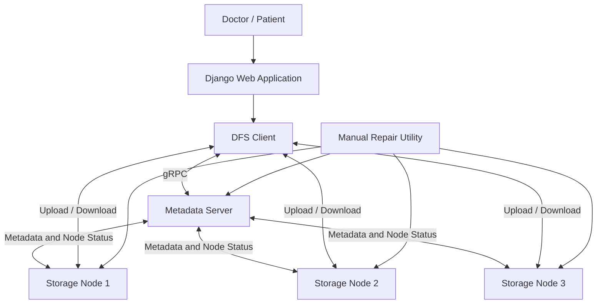

# MediFlow-Nexus 🏥

### Fault-Tolerant Medical Document Storage Using Distributed Computing

MediFlow-Nexus is a healthcare management platform integrated with a prototype Distributed File Storage System (DFS). It combines hospital management functionality with distributed storage techniques to improve the availability, reliability, and integrity of medical documents.

The project demonstrates how distributed computing concepts such as data chunking, replication, heartbeat-based failure detection, fault tolerance, and replica recovery can be applied to healthcare document storage.

---

## 📌 Project Overview

Traditional centralized file storage can become a single point of failure. If the storage service becomes unavailable, users may lose access to important documents.

MediFlow-Nexus addresses this challenge by integrating a Distributed File Storage System into an existing Django-based Hospital Management System.

The distributed storage component divides files into smaller chunks and stores replicated copies across multiple storage nodes. A metadata server maintains information about files, chunks, replicas, and storage-node availability.

If a storage node becomes unavailable, the system can attempt to retrieve the required data from another available replica.

## ✨ Key Features

### 🏥 Hospital Management System

- User registration and authentication.
- Doctor and patient management.
- Doctor and patient dashboards.
- Appointment booking and management.
- Medical report upload and retrieval.
- Healthcare document management.
- Administrative management.
- Payment integration.
- External service integrations.

### 🌐 Distributed File Storage System

- Distributed client-server architecture.
- File chunking with a default chunk size of 64 KiB.
- Data replication with a replication factor of 2.
- Centralized metadata management.
- gRPC-based inter-service communication.
- Protocol Buffers for service definitions and message serialization.
- Heartbeat-based storage-node monitoring.
- Storage-node failure detection.
- Replica fallback during file retrieval.
- Manual replica repair.
- SHA-256 file integrity verification.

---

## 🏗️ System Architecture

MediFlow-Nexus consists of the Hospital Management System and a separate distributed storage prototype.



### Main Components

| Component | Responsibility |
|---|---|
| Django Application | Handles users, doctors, patients, appointments, and medical reports. |
| DFS Client | Uploads, downloads, chunks, and reconstructs files. |
| Metadata Server | Tracks file metadata, chunk locations, replicas, and node health. |
| Storage Nodes | Store file chunks and their replicated copies. |
| Repair Utility | Attempts to restore missing replicas using available copies. |

### Storage Configuration

| Configuration | Value |
|---|---|
| Default chunk size | 64 KiB |
| Replication factor | 2 |
| Metadata server | 127.0.0.1:60501 |
| Storage Node 1 | 127.0.0.1:60511 |
| Storage Node 2 | 127.0.0.1:60512 |
| Storage Node 3 | 127.0.0.1:60513 |
| Heartbeat interval | Approximately 2 seconds |
| Node failure threshold | Approximately 6 seconds |

These are the default local prototype settings and may be configurable in the source code.

---

## ⚙️ Distributed Computing Concepts

The project demonstrates the following concepts:

### 1. Distributed Client-Server Architecture

The application communicates with separate metadata and storage processes rather than relying exclusively on one file-storage process.

### 2. File Chunking

Files are divided into smaller chunks of 64 KiB by default.

This allows the storage system to manage and distribute file data in smaller units.

### 3. Data Replication

Each chunk is intended to have two replicas stored across separate storage nodes.

Replication provides redundancy when a storage node becomes unavailable.

### 4. Metadata Management

The metadata server maintains information about stored files, their chunks, replica locations, and storage-node status.

Metadata is persisted locally using JSON.

### 5. gRPC and Protocol Buffers

gRPC enables communication between the distributed components.

Protocol Buffers define the messages and service interfaces used for communication.

### 6. Heartbeat-Based Failure Detection

Storage nodes periodically send heartbeat messages to the metadata server.

If a node stops sending heartbeats beyond the configured timeout, it can be marked unavailable.

### 7. Fault Tolerance and Replica Fallback

When a storage node becomes unavailable, the client can attempt to retrieve the required chunk from another available replica.

### 8. Manual Replica Repair

A repair utility attempts to restore missing replicas using surviving copies.

Repair is manually initiated in this prototype.

### 9. Data Integrity Verification

SHA-256 hashing is used to verify that retrieved or reconstructed file contents match the original data.

### 10. Lamport Logical Clock

A logical timestamp is used as an event-ordering hint. It does not provide consensus or guarantee globally consistent ordering.

---

## 🛠️ Technology Stack

| Technology | Purpose |
|---|---|
| Python | Distributed storage implementation |
| Django | Hospital Management System backend |
| HTML / Bootstrap | Web interface |
| JavaScript | Frontend interactions |
| SQLite | Local development database |
| gRPC | Distributed service communication |
| Protocol Buffers | Message and service definitions |
| SHA-256 | File integrity verification |
| JSON | Local metadata persistence |
| Node.js | Email service component, where applicable |

---

## 📂 Project Structure

```text
MediFlow-Nexus/
│
├── hms/
│   ├── accounts/
│   ├── admin_management/
│   ├── bookings/
│   ├── config/
│   ├── doctors/
│   ├── notifications/
│   ├── patients/
│   ├── services/
│   ├── templates/
│   └── manage.py
│
├── proto/
│   └── dfs.proto
│
├── email-service/
│
├── dfs_client.py
├── dfs_metadata.py
├── dfs_storage.py
├── dfs_repair.py
│
├── dfs_pb2.py
├── dfs_pb2_grpc.py
├── net_config.py
│
├── requirements.txt
├── .env.example
├── .gitignore
└── README.md
```

*The structure above highlights the main components. Refer to the repository for the complete source tree.*

---

## 🚀 Getting Started

### Prerequisites

Install or configure:

- Python 3.10 or later.
- Git.
- pip.
- Windows PowerShell or a compatible terminal.
- Required Python dependencies.
- Node.js and npm if running the email-service component.

### 1. Clone the repository

```bash
git clone https://github.com/MuktaRedij/MediFlow-Nexus.git
cd MediFlow-Nexus
```

### 2. Create a Python virtual environment

```bash
python -m venv venv
```

Activate it on Windows:

```powershell
.\venv\Scripts\Activate.ps1
```

### 3. Install Python dependencies

```bash
pip install -r requirements.txt
```

### 4. Configure environment variables

Create a local `.env` file using `.env.example` as a reference.

Configure the required values for:

- Django secret key and allowed hosts.
- Database connection.
- Google OAuth, if used.
- Email service URL.
- Razorpay credentials, if used.

Never commit the actual `.env` file or production credentials.

### 5. Initialize the Django application

Navigate to the Django project:

```powershell
cd hms
```

Run the database migrations:

```powershell
..\venv\Scripts\python.exe manage.py migrate
```

Check the Django configuration:

```powershell
..\venv\Scripts\python.exe manage.py check
```

### 6. Start the Django application

```powershell
..\venv\Scripts\python.exe manage.py runserver 127.0.0.1:8000
```

Open:

http://127.0.0.1:8000/

---

## 🖥️ Running the Distributed File Storage System

Open separate PowerShell terminals for the metadata server and each storage node.

Run these commands from the project root.

### Terminal 1: Start Metadata Server

```powershell
.\venv\Scripts\python.exe .\dfs_metadata.py
```

The metadata server listens on:

```text
127.0.0.1:60501
```

### Terminal 2: Start Storage Node 1

```powershell
.\venv\Scripts\python.exe .\dfs_storage.py 1
```

### Terminal 3: Start Storage Node 2

```powershell
.\venv\Scripts\python.exe .\dfs_storage.py 2
```

### Terminal 4: Start Storage Node 3

```powershell
.\venv\Scripts\python.exe .\dfs_storage.py 3
```

### Terminal 5: Check DFS Status

From the project root:

```powershell
.\venv\Scripts\python.exe .\dfs_client.py status
```

This command displays the available storage-node status.

### Check Replica Repair

```powershell
.\venv\Scripts\python.exe .\dfs_repair.py
```

The repair utility attempts to restore missing replicas when a valid source replica is available.

---

## 🧪 Testing

The project includes Django application tests and distributed storage verification workflows.

### Django System Check

```powershell
cd hms
..\venv\Scripts\python.exe manage.py check
```

### Migration Consistency Check

```powershell
..\venv\Scripts\python.exe manage.py makemigrations --check --dry-run
```

### Run Application Tests

```powershell
..\venv\Scripts\python.exe manage.py test patients.tests doctors.tests
```

### Distributed Storage Test Scenarios

The distributed storage prototype can be demonstrated using these scenarios:

| Test scenario | Expected behavior |
|---|---|
| Upload a file | File is divided into chunks and replicas are stored. |
| Download a file | Chunks are retrieved and reconstructed. |
| Compare SHA-256 hashes | Original and downloaded file hashes match. |
| Stop one storage node | Metadata detects the unavailable node after the timeout. |
| Retrieve data during node failure | Client attempts to use another healthy replica. |
| Run manual repair | Missing replicas are recreated when possible. |
| Stop too many nodes | Upload may be rejected when the required replication cannot be satisfied. |
| Stop metadata service | Metadata-dependent operations become unavailable. |

The Django tests and distributed storage integration tests should be considered separately: mocked Django tests do not by themselves prove live end-to-end DFS operation.

---

## 🔒 Security and Data Handling

- Keep secret keys and API credentials in local environment variables.
- Do not commit `.env` files.
- Do not publish real medical records or patient information.
- Use synthetic documents when demonstrating uploads and downloads.
- Protect production payment credentials.
- Configure secure Django settings before deployment.
- The current prototype uses local insecure gRPC channels and is intended for development and academic demonstration.

---

## ⚠️ Current Limitations

MediFlow-Nexus is an academic prototype and is not intended to be a production-ready healthcare storage platform.

Known limitations include:

- Metadata server is a single point of failure.
- No Raft or Paxos consensus implementation.
- No metadata high availability or leader election.
- Replica repair is manually triggered.
- No automatic distributed transaction management.
- No distributed mutual exclusion or deadlock detection implementation.
- Storage nodes run as separate processes on localhost in the default demonstration.
- gRPC channels are not configured with production-grade transport security.
- The email-service component requires a real delivery provider for actual email delivery.

These limitations are acknowledged to distinguish the implemented prototype from a production distributed storage system.

---

## 🎯 Project Objectives

1. Demonstrate distributed computing concepts through a practical healthcare application.
2. Improve medical document availability using replicated storage.
3. Demonstrate storage-node failure detection.
4. Support retrieval through available replicas.
5. Verify file integrity using SHA-256.
6. Explore the integration of distributed storage with an existing Django application.

---

## 👩‍💻 Project Information

**Project Name:** MediFlow-Nexus

**Domain:** Distributed Computing and Healthcare Management

**Primary Focus:** Fault-Tolerant Distributed File Storage

**Repository:** https://github.com/MuktaRedij/MediFlow-Nexus

---

## 📜 Disclaimer

This project is developed for educational and academic demonstration purposes. It is not a certified medical records platform and should not be used to store real patient information or sensitive healthcare data in its current form.

---

### Built to explore reliable healthcare document storage through distributed computing. 🏥🌐
